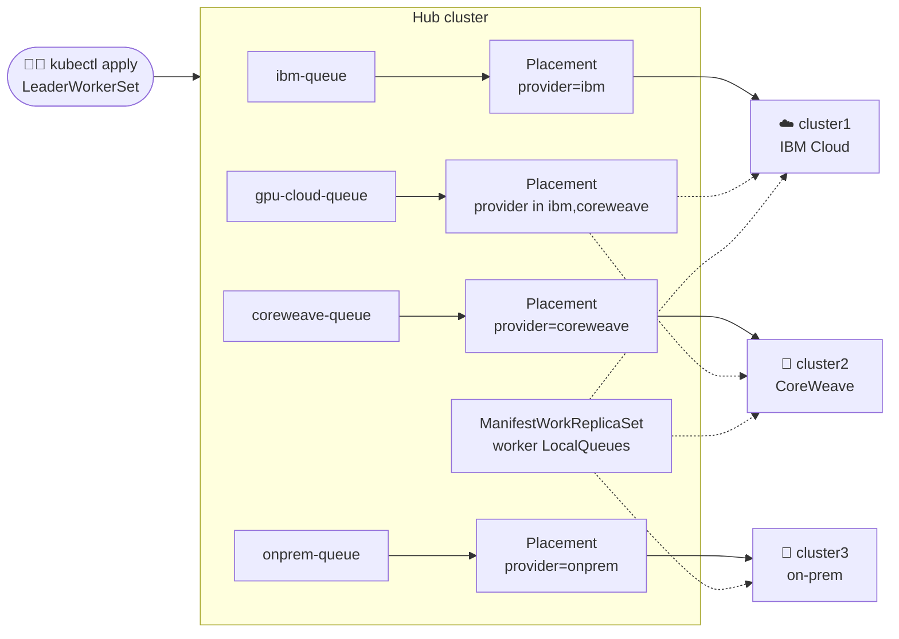

# One queue per cloud: LeaderWorkerSet across IBM Cloud, CoreWeave and on-prem

> Submit an inference service once, to one hub. Its queue decides whether it runs on
> **IBM Cloud**, **CoreWeave**, or your **own data center**. Onboard a new cluster with one
> label and the waiting work starts running there.

This example combines three projects:

- **[Open Cluster Management](https://open-cluster-management.io/)** (OCM) registers the
  clusters, chooses them by label with `Placement`, and pushes configuration to them.
- **[Kueue MultiKueue](https://kueue.sigs.k8s.io/docs/concepts/multikueue/)** sends admitted
  workloads from the hub to a worker cluster.
- **[LeaderWorkerSet](https://github.com/kubernetes-sigs/lws)** (LWS) runs multi-node
  inference as groups of pods: one leader and its workers.

The **kueue-addon** connects them. It creates and rotates the credentials MultiKueue uses to
reach each worker, and it turns each `Placement` into a `MultiKueueConfig`, so you never
maintain lists of clusters or kubeconfigs by hand.

---

## The scenario

You run LLM inference for a company that buys GPUs from three places:

| | Cluster | Label | Use it for |
|---|---|---|---|
| ☁️ | `cluster1` | `provider=ibm` | General serving on IBM Cloud |
| 🚀 | `cluster2` | `provider=coreweave` | Large GPU jobs such as disaggregated serving |
| 🏢 | `cluster3` | `provider=onprem` | Regulated data that may not leave the building |

Users shouldn't need a kubeconfig for each cloud. They pick a **queue**, and the platform
handles placement:



Each arrow from a Placement is a `MultiKueueConfig` that the addon created. The hub only stores
the LWS objects. The pods run on the workers.

---

## Quick start

You need the kind environment from [`build/setup-env.sh`](../../build/setup-env.sh): a hub plus
three workers with Kueue v0.20+. The workers run the LWS controller, the hub has only the LWS
CRD, and the hub has the `ManifestWorkReplicaSet` feature enabled (`setup.sh` enables it if it
is missing).

```bash
cd examples/lws-multi-provider
./setup.sh     # label clusters, create Placements, queues and AdmissionChecks
./demo.sh      # narrated live walk-through (PAUSE=6 ./demo.sh when presenting)
```

`setup.sh` ends by showing the `MultiKueueConfig`s that the addon generated from the Placements:

```
LocalQueues available on 3/3 worker clusters
MKCONFIG    CLUSTERS
ibm         [cluster1]
coreweave   [cluster2]
onprem      [cluster3]
gpu-cloud   [cluster1 cluster2]
```

---

## What `demo.sh` shows

The demo starts with `cluster3` registered with OCM but **not yet labelled** as on-prem.

### 1. Disaggregated serving on CoreWeave 🚀

Disaggregated serving splits an LLM into a **prefill** stage, which processes the prompt, and a
**decode** stage, which generates tokens. Each stage scales on its own. Here each stage is an LWS,
and both use `coreweave-queue`:

```yaml
apiVersion: leaderworkerset.x-k8s.io/v1
kind: LeaderWorkerSet
metadata:
  name: llama-decode
  namespace: inference
  labels:
    kueue.x-k8s.io/queue-name: coreweave-queue   # ← this line picks the cloud
spec:
  replicas: 2            # 2 groups → 2 Kueue Workloads
  leaderWorkerTemplate:
    size: 2              # 1 leader + 1 worker per group
```

### 2. Regulated work waits for an on-prem cluster 🏢

`granite-ds` is submitted to `onprem-queue` before any cluster has `provider=onprem`. The
`onprem` Placement selects nothing, so there is no `MultiKueueConfig` and the queue holds the
work:

```
onprem-queue: Can't admit new workloads: references inactive AdmissionCheck(s): mk-onprem.
```

### 3. Onboard the on-prem cluster with one label

```bash
kubectl label managedcluster cluster3 provider=onprem
```

The addon creates `MultiKueueConfig onprem` with `[cluster3]`, and the waiting `granite-ds`
workloads start running there. In testing this took about 7 seconds. Nothing on the queues
changed, and cluster3 already had its LocalQueues because the ManifestWorkReplicaSet targets
every worker.

### 4. Multi-node serving on IBM Cloud ☁️

`mixtral` runs 2 LWS groups on `ibm-queue`.

### 5. Burst to any public cloud

`burst-a` and `burst-b` use `gpu-cloud-queue`, which allows IBM Cloud or CoreWeave but never
on-prem. MultiKueue sends each one to whichever cluster admits it first.

### The result

This is real output from a run on the kind clusters:

```
[hub] Kueue workloads (one per LWS group)
  WORKLOAD                                 QUEUE             ADMITTED  WORKER
  leaderworkerset-burst-a-0-3772f          gpu-cloud-queue   True      cluster1
  leaderworkerset-burst-b-0-8dd97          gpu-cloud-queue   True      cluster1
  leaderworkerset-granite-decode-0-46ce7   onprem-queue      True      cluster3
  leaderworkerset-granite-prefill-0-1dd34  onprem-queue      True      cluster3
  leaderworkerset-llama-decode-0-27a4f     coreweave-queue   True      cluster2
  leaderworkerset-llama-decode-1-c591e     coreweave-queue   True      cluster2
  leaderworkerset-llama-prefill-0-50693    coreweave-queue   True      cluster2
  leaderworkerset-mixtral-0-cccbb          ibm-queue         True      cluster1
  leaderworkerset-mixtral-1-39382          ibm-queue         True      cluster1
[cluster1 / ibm] pods
  burst-a-0              app=burst       role=serving  leader  Running
  burst-a-0-1            app=burst       role=serving  worker  Running
  burst-b-0              app=burst       role=serving  leader  Running
  burst-b-0-1            app=burst       role=serving  worker  Running
  mixtral-0              app=mixtral     role=serving  leader  Running
  mixtral-0-1            app=mixtral     role=serving  worker  Running
  mixtral-1              app=mixtral     role=serving  leader  Running
  mixtral-1-1            app=mixtral     role=serving  worker  Running
[cluster2 / coreweave] pods
  llama-decode-0         app=llama-ds    role=decode   leader  Running
  llama-decode-0-1       app=llama-ds    role=decode   worker  Running
  llama-decode-1         app=llama-ds    role=decode   leader  Running
  llama-decode-1-1       app=llama-ds    role=decode   worker  Running
  llama-prefill-0        app=llama-ds    role=prefill  leader  Running
  llama-prefill-0-1      app=llama-ds    role=prefill  worker  Running
[cluster3 / onprem] pods
  granite-decode-0       app=granite-ds  role=decode   leader  Running
  granite-decode-0-1     app=granite-ds  role=decode   worker  Running
  granite-prefill-0      app=granite-ds  role=prefill  leader  Running
  granite-prefill-0-1    app=granite-ds  role=prefill  worker  Running

9 workloads admitted, 18 pods running.
```

All 9 workloads ran on the provider their queue allows. The hub runs no pods, and deleting the
LWS objects on the hub removes them from the workers.

---

## Why OCM? The same setup without it

MultiKueue can do the routing on its own. Here is what you would maintain by hand for the same
three clusters:

```bash
# For EVERY worker: create a ServiceAccount, RBAC and a kubeconfig with Kueue's script,
# then copy that kubeconfig to the hub. Repeat when the token expires.
./create-multikueue-kubeconfig.sh cluster2.kubeconfig        # run against cluster2
kubectl --context hub create secret generic cluster2-kubeconfig -n kueue-system \
  --from-file=kubeconfig=cluster2.kubeconfig

# For EVERY worker: apply the LocalQueues to it directly.
kubectl --context cluster2 apply -f worker-localqueues.yaml
```

```yaml
# For EVERY worker: a MultiKueueCluster on the hub
apiVersion: kueue.x-k8s.io/v1beta2
kind: MultiKueueCluster
metadata:
  name: cluster2
spec:
  clusterSource:
    kubeConfig: {locationType: Secret, location: cluster2-kubeconfig}
---
# For EVERY provider: a hand-written cluster list, edited whenever clusters change
apiVersion: kueue.x-k8s.io/v1beta2
kind: MultiKueueConfig
metadata:
  name: coreweave
spec:
  clusters: [cluster2]
```

| Task | Plain MultiKueue | With OCM and the kueue-addon |
|---|---|---|
| Worker credentials | Run a script per cluster, copy the kubeconfig, rotate it yourself | `ManagedServiceAccount` creates and rotates the tokens |
| Worker RBAC | Applied by the script | `ClusterPermission`, kept in sync with Kueue |
| Which clusters a queue uses | Edit `MultiKueueConfig` by hand | Label the cluster; the `Placement` decides |
| Onboarding a cluster | Credentials, secret, `MultiKueueCluster`, config edits, worker queues | `kubectl label managedcluster <name> provider=<p>` |
| Worker LocalQueues | `kubectl apply` against each cluster | One `ManifestWorkReplicaSet` that follows a `Placement` |

With three clusters that never change, plain MultiKueue is manageable. OCM pays off when
clusters come and go, tokens need rotating, or the fleet grows.

---

## Try this next

**Move a provider to another cluster.** Label `cluster3` as CoreWeave too and watch the configs
update:

```bash
kubectl --context kind-local-cluster label managedcluster cluster3 provider=coreweave --overwrite
kubectl --context kind-local-cluster get multikueueconfig coreweave -o jsonpath='{.spec.clusters}'
# ["cluster3","cluster2"]
kubectl --context kind-local-cluster get multikueueconfig onprem
# Error from server (NotFound): ... "onprem" not found
```

New `coreweave-queue` workloads can now run on either cluster. The `onprem` Placement now
matches no clusters, so the addon deletes the `onprem` MultiKueueConfig, and `onprem-queue`
stops dispatching until a cluster has the label again. Run `./setup.sh` to restore the labels.

**Add a region or GPU type.** A Placement can select on any cluster label, such as
`accelerator=nvidia-h100` or `region=us-east`, and can combine several. Copy one block from
[`hub/queues.yaml`](hub/queues.yaml) and [`hub/placements.yaml`](hub/placements.yaml), and add
the new LocalQueue to [`hub/worker-queues.yaml`](hub/worker-queues.yaml).

**Keep each LWS group in one rack.** The [topology-aware example](../lws-topology-aware/README.md)
adds Kueue Topology Aware Scheduling to these providers, each of which labels its topology
differently.

---

## How it works

```
LeaderWorkerSet ──► Kueue Workload (one per LWS group) ──► ClusterQueue cq-<provider>
                                                                 │
                                       AdmissionCheck mk-<provider> (kueue.x-k8s.io/multikueue)
                                                                 │
                                       MultiKueueConfig <provider>  ◄── written by kueue-addon
                                                                 ▲      from Placement <provider>
                                                                 │      (AdmissionCheck ocm-<provider>)
                                                     worker cluster(s)
```

Details to keep in mind:

- **One Workload per LWS group.** Kueue admits each group separately. MultiKueue keeps all groups
  of one LWS on the same worker, so a 2-replica LWS is never split across clouds.
- **Put prefill and decode on a single-provider queue.** They are two separate LWS objects, and
  MultiKueue places each one on its own. On a multi-cluster queue such as `gpu-cloud` they could
  land on different clusters and break the KV-cache transfer between them.
- **`DisaggregatedSet` is not used.** LWS v1.0 has a `DisaggregatedSet` API, but Kueue has no
  MultiKueue integration for it, so this example uses two plain LWS objects.
- **Workers need the same LocalQueue names.** MultiKueue creates the remote Workload in the same
  namespace with the same queue name. [`hub/worker-queues.yaml`](hub/worker-queues.yaml) is a
  `ManifestWorkReplicaSet` that puts every LocalQueue on every worker the `lws-workers`
  Placement selects, including clusters that join later.
- **Only the MultiKueue check goes on the ClusterQueue.** The `ocm-*` checks keep the
  `MultiKueueConfig`s up to date but are not listed on the ClusterQueues. Since Kueue v0.20,
  MultiKueue waits for every other check on a workload to be Ready before dispatching it, and the
  OCM check never marks workloads Ready. Listing it would leave workloads stuck in `Pending`.
- **Changing a Placement moves running workloads.** When a cluster drops out of a
  `MultiKueueConfig`, MultiKueue treats the copy there as lost and recreates the workload on a
  remaining cluster. Changing a label is therefore a migration, not just a routing change for new
  work.
- **Don't rank clusters by live load with `numberOfClusters: 1`.** A Placement that keeps only the
  cluster with the most free CPU (from the `resource-usage-score` `AddOnPlacementScore`) looks
  like capacity-aware placement, but in testing it made a serving workload bounce between IBM
  Cloud and CoreWeave every 30–60 seconds. Each move used up capacity on the new cluster, which
  flipped the ranking back. Use labels, or scores that the workloads themselves don't change.
- **The hub only needs the LWS CRD.** It is the MultiKueue manager and stores the objects, while
  the LWS controller on each worker creates the pods.
- **No GPUs needed for the demo.** The containers are `busybox` and request only CPU. The "GPU
  cloud" exists only in the labels and queue names, so everything runs on a laptop.

## Files

```
lws-multi-provider/
├── setup.sh                  # labels, hub queues, worker queues
├── demo.sh                   # narrated live demo
├── hub/
│   ├── placements.yaml       # ibm, coreweave, onprem, gpu-cloud
│   ├── queues.yaml           # AdmissionChecks, ClusterQueues, LocalQueues
│   └── worker-queues.yaml    # ManifestWorkReplicaSet: LocalQueues on every worker
└── workloads/
    ├── 01-ds-coreweave.yaml  # llama prefill + decode
    ├── 02-ds-onprem.yaml     # granite prefill + decode
    ├── 03-lws-ibm.yaml       # mixtral, 2 groups
    └── 04-lws-gpu-cloud.yaml # burst-a / burst-b
```

## Clean up

```bash
kubectl --context kind-local-cluster delete lws -n inference --all
kubectl --context kind-local-cluster delete -f hub/worker-queues.yaml   # removes worker LocalQueues
kubectl --context kind-local-cluster delete -f hub/queues.yaml -f hub/placements.yaml
```

`hub/queues.yaml` also creates the shared `default-flavor` ResourceFlavor. If other queues on the
hub use it, recreate it after cleaning up.
