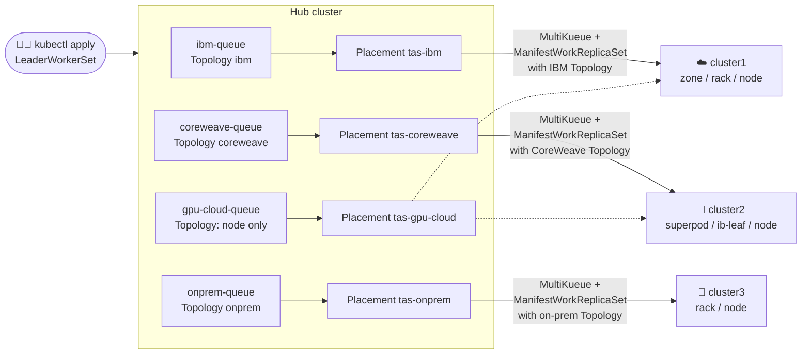

# Same rack, different labels: topology-aware LeaderWorkerSet across clouds

> Multi-node inference is fastest when a leader and its workers share a rack or a network
> switch. Every provider labels its racks differently. This example keeps that knowledge in
> **one place per provider**, so users pick a queue and Kueue places each LWS group in one rack,
> InfiniBand leaf or data-center rack, depending on the cluster it lands on.

This builds on the [LWS multi-provider example](../lws-multi-provider/README.md), which routes
LeaderWorkerSets to IBM Cloud, CoreWeave or on-prem clusters by queue. Here, each of those
clusters also uses **Kueue
[Topology Aware Scheduling](https://kueue.sigs.k8s.io/docs/concepts/topology_aware_scheduling/)
(TAS)** to decide which nodes inside the cluster get the pods.

---

## The scenario

The same three clusters as before, but now we care about the shape of each one's GPU fabric:

| | Cluster | Provider | Topology levels (widest → narrowest) | Shape |
|---|---|---|---|---|
| ☁️ | `cluster1` | `ibm` | `ibm.example.com/zone` → `ibm.example.com/rack` → node | 2 zones × 2 racks × 2 nodes |
| 🚀 | `cluster2` | `coreweave` | `coreweave.example.com/superpod` → `coreweave.example.com/ib-leaf` → node | 2 superpods × 2 leaves × 2 nodes |
| 🏢 | `cluster3` | `onprem` | `dc.example.com/rack` → node | 3 racks × 2 nodes |

The label keys are illustrative; real providers use keys such as
`cloud.google.com/gce-topology-block` or `topology.k8s.aws/network-node-layer-1`. What matters
is that **no two providers use the same keys, and their trees aren't even the same depth**.

A TAS request names a node label, such as "all pods in one `ibm.example.com/rack`". That label
only means something on IBM clusters. So the topology belongs with the provider, and so does
the queue:



Each provider `Placement` does two jobs:

1. The kueue-addon turns it into a `MultiKueueConfig`, so the queue sends work to those clusters.
2. A `ManifestWorkReplicaSet` uses it to push that provider's `Topology`, TAS `ResourceFlavor`,
   `ClusterQueue` and `LocalQueue`s to the same clusters.

The platform team describes a provider's topology once. Every cluster that gets the
`provider=<name>` label receives it, with no per-cluster setup.

---

## Quick start

You need the kind environment from [`build/setup-env.sh`](../../build/setup-env.sh): a hub plus
three workers with Kueue v0.20+, the LWS controller on the workers and the LWS CRD on the hub.

```bash
cd examples/lws-topology-aware
./setup.sh      # KWOK fake nodes, provider labels, Placements, Topologies and queues
./demo.sh       # narrated live walk-through (PAUSE=6 ./demo.sh when presenting)
./teardown.sh   # remove everything this example added
```

The kind workers have a single real node each, which can't show racks. `setup.sh` installs
[KWOK](https://kwok.sigs.k8s.io/) v0.8.0 on each worker and adds fake GPU nodes (2 CPU, 8Gi)
with that provider's topology labels. KWOK marks the pods on them `Running` without starting
containers. The fake nodes are tainted, so nothing else in the cluster lands on them.

---

## What `demo.sh` shows

The demo starts with `cluster3` registered with OCM but **not yet labelled** as on-prem.

### 1. Three providers, three vocabularies

```
$ kubectl --context kind-cluster1 get nodes -l type=kwok -L ibm.example.com/zone -L ibm.example.com/rack
NAME           STATUS   ZONE   RACK
ibm-z1-r1-n1   Ready    z1     z1-r1
ibm-z1-r1-n2   Ready    z1     z1-r1
ibm-z1-r2-n1   Ready    z1     z1-r2
...
$ kubectl --context kind-cluster2 get nodes -l type=kwok -L coreweave.example.com/superpod -L coreweave.example.com/ib-leaf
NAME              STATUS   SUPERPOD   IB-LEAF
cw-sp1-leaf1-n1   Ready    sp1        sp1-leaf1
...
$ kubectl --context kind-cluster3 get nodes -l type=kwok -L dc.example.com/rack
NAME        STATUS   RACK
dc-a01-n1   Ready    a01
...
```

### 2. One Topology per provider, on the hub and on its workers

```
TOPOLOGY    LEVELS
ibm         ibm.example.com/zone,ibm.example.com/rack,kubernetes.io/hostname
coreweave   coreweave.example.com/superpod,coreweave.example.com/ib-leaf,kubernetes.io/hostname
onprem      dc.example.com/rack,kubernetes.io/hostname
gpu-cloud   kubernetes.io/hostname
```

The hub never places pods. With a MultiKueue check on the ClusterQueue, Kueue checks that the
requested level exists in the hub flavor's Topology, reserves quota, and leaves the actual node
assignment to the worker (a *delayed topology request*). The worker's own Kueue then does the
real TAS placement against its nodes.

### 3. Multi-node serving on IBM Cloud: one rack per group ☁️

The TAS annotations go on both pod templates of the LWS. `podset-group-name` makes the leader and
its workers count as one unit, so they share a single domain:

```yaml
metadata:
  name: mixtral
  labels:
    kueue.x-k8s.io/queue-name: ibm-queue
spec:
  replicas: 2
  leaderWorkerTemplate:
    size: 4                       # 4 × 1 CPU = exactly one IBM rack (2 nodes × 2 CPU)
    leaderTemplate:
      metadata:
        annotations:
          kueue.x-k8s.io/podset-required-topology: ibm.example.com/rack
          kueue.x-k8s.io/podset-group-name: mixtral
    workerTemplate:
      metadata:
        annotations:
          kueue.x-k8s.io/podset-required-topology: ibm.example.com/rack
          kueue.x-k8s.io/podset-group-name: mixtral
```

Each group fills one rack: `mixtral-0` in `z1-r1`, `mixtral-1` in `z1-r2`.

### 4. Disaggregated serving on CoreWeave: one InfiniBand leaf per group 🚀

`llama-prefill` and `llama-decode` use `coreweave-queue` and require
`coreweave.example.com/ib-leaf`. The prefill group fills `sp1-leaf1`, and both decode groups fit
behind `sp1-leaf2`.

### 5. A mistake: the wrong provider's label

`llama-typo` asks for `ibm.example.com/rack` on `coreweave-queue`. The hub rejects it **before
anything is dispatched**, because the CoreWeave Topology has no such level:

```
couldn't assign flavors to pod set leader: Flavor "coreweave-tas" does not contain the requested level
```

Without a per-provider Topology on the hub, this workload would be sent to CoreWeave and sit
there unschedulable.

### 6. Regulated work waits for an on-prem cluster 🏢

`granite` requires `dc.example.com/rack` on `onprem-queue`. No cluster has `provider=onprem`, so
there is no `MultiKueueConfig` and the queue holds it:

```
onprem-queue: Can't admit new workloads: references inactive AdmissionCheck(s): mk-tas-onprem.
```

### 7. Onboard the on-prem cluster with one label

```bash
kubectl label managedcluster cluster3 provider=onprem
```

That one label makes OCM:

- create `MultiKueueConfig tas-onprem` with `[cluster3]`, and
- apply the on-prem `Topology`, `ResourceFlavor`, `ClusterQueue` and `LocalQueue` to cluster3.

In testing, both were in place within about 5 seconds, and `granite` started in rack `a01`.

### 8. Burst to any public cloud: prefer the level they share

`gpu-cloud-queue` may use IBM Cloud or CoreWeave, which share no rack label. The only level both
have is the node, so the burst workloads **prefer** `kubernetes.io/hostname`:

```yaml
kueue.x-k8s.io/podset-preferred-topology: kubernetes.io/hostname
kueue.x-k8s.io/podset-group-name: burst-a
```

A preferred request means "on one node if possible". If a group doesn't fit, Kueue widens to the
next level of whichever cluster runs it: an IBM rack or a CoreWeave leaf. One manifest gets
compact placement on both clouds.

### The result

This is real output from a run on the kind clusters:

```
[hub] Kueue workloads (one per LWS group)
  WORKLOAD                                 QUEUE             ADMITTED  WORKER
  leaderworkerset-burst-a-0-1a79e          gpu-cloud-queue   True      cluster1
  leaderworkerset-burst-b-0-8e2c4          gpu-cloud-queue   True      cluster1
  leaderworkerset-granite-0-df3d9          onprem-queue      True      cluster3
  leaderworkerset-llama-decode-0-c2f62     coreweave-queue   True      cluster2
  leaderworkerset-llama-decode-1-9b23e     coreweave-queue   True      cluster2
  leaderworkerset-llama-prefill-0-f7a9a    coreweave-queue   True      cluster2
  leaderworkerset-mixtral-0-b1fd4          ibm-queue         True      cluster1
  leaderworkerset-mixtral-1-bb709          ibm-queue         True      cluster1
[cluster1 / ibm] pods → node → zone/rack
  mixtral-0            leader  ibm-z1-r1-n1         z1/z1-r1         Running
  mixtral-0-1          worker  ibm-z1-r1-n1         z1/z1-r1         Running
  mixtral-0-2          worker  ibm-z1-r1-n2         z1/z1-r1         Running
  mixtral-0-3          worker  ibm-z1-r1-n2         z1/z1-r1         Running
  mixtral-1            leader  ibm-z1-r2-n1         z1/z1-r2         Running
  mixtral-1-1          worker  ibm-z1-r2-n1         z1/z1-r2         Running
  mixtral-1-2          worker  ibm-z1-r2-n2         z1/z1-r2         Running
  mixtral-1-3          worker  ibm-z1-r2-n2         z1/z1-r2         Running
  burst-a-0            leader  ibm-z2-r1-n1         z2/z2-r1         Running
  burst-a-0-1          worker  ibm-z2-r1-n1         z2/z2-r1         Running
  burst-b-0            leader  ibm-z2-r1-n2         z2/z2-r1         Running
  burst-b-0-1          worker  ibm-z2-r1-n2         z2/z2-r1         Running
[cluster2 / coreweave] pods → node → superpod/ib-leaf
  llama-prefill-0      leader  cw-sp1-leaf1-n1      sp1/sp1-leaf1    Running
  llama-prefill-0-1    worker  cw-sp1-leaf1-n1      sp1/sp1-leaf1    Running
  llama-prefill-0-2    worker  cw-sp1-leaf1-n2      sp1/sp1-leaf1    Running
  llama-prefill-0-3    worker  cw-sp1-leaf1-n2      sp1/sp1-leaf1    Running
  llama-decode-0       leader  cw-sp1-leaf2-n1      sp1/sp1-leaf2    Running
  llama-decode-0-1     worker  cw-sp1-leaf2-n1      sp1/sp1-leaf2    Running
  llama-decode-1       leader  cw-sp1-leaf2-n2      sp1/sp1-leaf2    Running
  llama-decode-1-1     worker  cw-sp1-leaf2-n2      sp1/sp1-leaf2    Running
[cluster3 / onprem] pods → node → rack
  granite-0            leader  dc-a01-n1            a01              Running
  granite-0-1          worker  dc-a01-n1            a01              Running
  granite-0-2          worker  dc-a01-n2            a01              Running
  granite-0-3          worker  dc-a01-n2            a01              Running

8 workloads admitted, 24 pods running.
```

Every group sits inside a single domain of its own cluster's topology, and each burst group
landed on a single node.

---

## How it works

```
LeaderWorkerSet ──► Workload per group ──► hub ClusterQueue cq-tas-<provider>
                                           flavor <provider>-tas → hub Topology <provider>
                                           (checks the level exists; topology request delayed)
                                                        │
                                           AdmissionCheck mk-tas-<provider> (MultiKueue)
                                                        │
                                           worker LocalQueue <provider>-queue
                                           ClusterQueue <provider>-tas → worker Topology <provider>
                                           (real TAS: picks a rack / leaf / node)
```

Details to keep in mind:

- **Keep the hub and worker Topologies the same.** The hub copy is in
  [`hub/queues.yaml`](hub/queues.yaml), and the worker copy is in
  [`hub/worker-topology.yaml`](hub/worker-topology.yaml). The hub copy only validates requests,
  so if the two disagree, a workload can pass the hub and then never schedule on the worker.
- **The hub flavor still needs `nodeLabels`.** Kueue requires a node selector on any flavor with a
  `topologyName`. The hub flavors use `type: kwok`, which matches no hub node, and that's fine
  because the hub never computes placements.
- **`podset-group-name` needs a required or preferred level.** Kueue rejects it together with
  `podset-unconstrained-topology`. That's why the burst workloads use a preferred `hostname`
  level rather than the unconstrained annotation.
- **A multi-provider queue can only promise what every provider has.** `gpu-cloud` lists just
  `kubernetes.io/hostname`. If a provider-specific label were added to the hub Topology,
  MultiKueue would still offer the workload to every cluster in the config, and only the clusters
  that have that label could ever admit it.
- **The ResourceFlavor carries the toleration.** The worker flavors select the fake GPU nodes
  (`type: kwok`) and add the `kwok.x-k8s.io/node` toleration to every pod they admit, so the
  workload manifests don't mention it. On real clusters, put your GPU node pool's label and taint
  here instead.
- **The work agent needs permission for Topologies.** The kueue-addon's `AddOnTemplate` binds the
  OCM work agent (`klusterlet-work-sa`) on each worker to Kueue's `kueue-topology-editor-role`,
  alongside the ResourceFlavor, ClusterQueue and LocalQueue roles. Without that binding the
  `ManifestWorkReplicaSet` applies everything except the Topology.
- **Only the MultiKueue check goes on the ClusterQueue.** As in the base example, the `ocm-tas-*`
  checks keep the `MultiKueueConfig`s up to date but aren't listed on the ClusterQueues.

## Files

```
lws-topology-aware/
├── setup.sh                     # KWOK + fake nodes, labels, hub objects, worker config
├── demo.sh                      # narrated live demo
├── teardown.sh                  # removes what setup.sh added (keeps provider labels)
├── hub/
│   ├── placements.yaml          # tas-ibm, tas-coreweave, tas-onprem, tas-gpu-cloud
│   ├── queues.yaml              # per-provider Topology, flavor, AdmissionChecks, queues
│   └── worker-topology.yaml     # one ManifestWorkReplicaSet per provider
└── workloads/
    ├── 01-lws-ibm.yaml          # mixtral: one IBM rack per group
    ├── 02-ds-coreweave.yaml     # llama prefill + decode: one ib-leaf per group
    ├── 03-wrong-label.yaml      # IBM label on the CoreWeave queue (rejected on the hub)
    ├── 04-lws-onprem.yaml       # granite: one data-center rack
    └── 05-lws-gpu-cloud.yaml    # burst-a / burst-b: prefer one node, on either cloud
```
