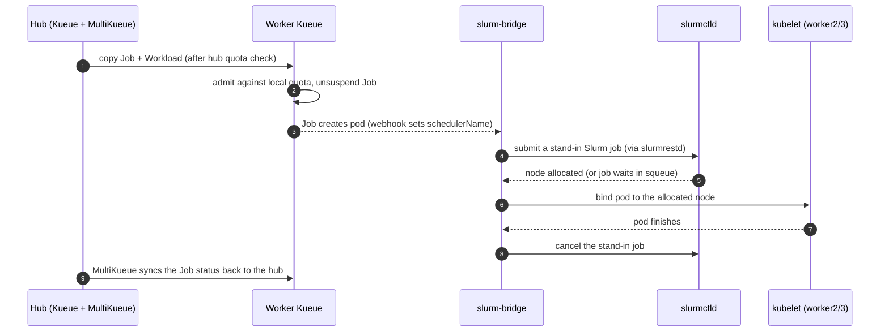

# Two schedulers, one queue: MultiKueue meets Slurm

> Submit a plain Kubernetes Job to one hub. Put it on `kube-queue` and the Kubernetes
> scheduler runs it. Put it on `slurm-queue` and **Slurm** decides where and when it runs,
> with its queue, its time limits and its whole-node allocation. Same YAML, same `kubectl`.

MultiKueue sends each job to a worker cluster. What happens inside that worker is up to the
worker. This example puts that to the test with a worker where the pod scheduler isn't
Kubernetes at all.

---

## The scenario

Your organization has two kinds of compute:

| | Cluster | Pods placed by | Run by |
|---|---|---|---|
| ☸️ | `cluster1` | the default **kube-scheduler** | the platform team |
| 🖥️ | `slurm-cluster` | **Slurm**, through [slurm-bridge](https://github.com/SlinkyProject/slurm-bridge) | the HPC team, who has run Slurm for years |

The researchers don't want to learn `sbatch`, and the HPC team doesn't want to give up Slurm. With
MultiKueue, nobody has to switch: researchers submit Kubernetes Jobs to one hub, and the queue
decides which scheduler gets the job.


### Who decides what

| Question | Answered by | Where |
|---|---|---|
| Which cluster runs this job? | OCM `Placement` + Kueue **MultiKueue** | Hub |
| Does it fit the team's quota? | Kueue `ClusterQueue` | Hub, then worker |
| Which node runs it, and when? | kube-scheduler on `cluster1`, **Slurm** on `slurm-cluster` | Worker |

---

## Quick start

You need the environment from [`build/setup-env.sh`](../../build/setup-env.sh). This example
reuses its hub (`local-cluster`) and `cluster1`, and adds one new cluster.

```bash
sudo sysctl fs.inotify.max_user_instances=2048   # each kind node needs inotify instances
cd examples/multikueue-slurm
./create-slurm-cluster.sh   # kind + Slurm + slurm-bridge + Kueue, joined to OCM (~4 min with cached images)
./setup.sh                  # hub queues, Placements and worker LocalQueues
./demo.sh                   # narrated live walk-through (PAUSE=6 ./demo.sh when presenting)
./teardown.sh               # remove everything this example added
```

| Component | Version |
|---|---|
| Kubernetes (kind node image) | v1.35.0 (slurm-bridge 1.2.x needs 1.35 or newer) |
| slurm-operator, Slurm chart, slurm-bridge | 1.2.4 (Slurm 26.05) |
| cert-manager | v1.21.2 |
| Kueue | v0.20.5 |

---

## Inside `slurm-cluster`

[slurm-operator](https://github.com/SlinkyProject/slurm-operator) runs the Slurm control plane
(`slurmctld` and `slurmrestd`) as ordinary pods. slurm-bridge then makes Slurm the scheduler
for two of the Kubernetes nodes:

| Node | Role |
|---|---|
| `control-plane` | Kubernetes control plane |
| `worker` | System node: slurmctld, slurmrestd, slurm-operator, slurm-bridge, Kueue, OCM agents |
| `worker2`, `worker3` | **Slurm nodes.** Labelled `scheduler.slinky.slurm.net/external-node=true` so slurm-bridge registers them in Slurm, and tainted so only slurm-bridge places pods there |

These nodes run no `slurmd`. slurm-bridge registers them in Slurm with their real CPU and memory,
and Slurm sees them like any other nodes:

```
NODELIST PARTITION CPUS MEMORY STATE
slurm-cluster-worker2 slurm-bridge* 16 63991 idle
slurm-cluster-worker3 slurm-bridge* 16 63991 idle
```

### The life of a job on `slurm-cluster`



### Joining the hub is one `clusteradm join`

`create-slurm-cluster.sh` joins the new cluster to the hub. About a minute later, the OCM
addons have set up everything MultiKueue needs on their own:

- **managed-serviceaccount** creates the token MultiKueue uses, and rotates it.
- **kueue-addon** writes the kubeconfig secret, creates the `MultiKueueCluster`, and deploys the
  worker's `cluster-queue`.
- The **`hpc-workers` ManifestWorkReplicaSet** pushes the `hpc` namespace and LocalQueues as soon
  as `setup.sh` labels the cluster `scheduler=slurm`.

---

## The jobs

[`workloads/01-job-kube-scheduler.yaml`](workloads/01-job-kube-scheduler.yaml) and
[`workloads/02-job-slurm.yaml`](workloads/02-job-slurm.yaml) are the same plain `batch/v1` Job.
Apart from the name, one line differs:

```yaml
apiVersion: batch/v1
kind: Job
metadata:
  generateName: train-slurm-
  namespace: hpc
  labels:
    kueue.x-k8s.io/queue-name: slurm-queue        # ← kube-queue in the other file
  annotations:
    slurmjob.slinky.slurm.net/job-name: train-slurm
    slurmjob.slinky.slurm.net/timelimit: "10"     # Slurm time limit, in minutes
spec:
  suspend: true
  template:
    spec:
      containers:
      - name: train
        image: busybox:1.36
        resources:
          requests: {cpu: "1", memory: 256Mi}
```

There's no `schedulerName` and no Slurm script:

- **The webhook picks the scheduler.** slurm-bridge's admission webhook sets
  `schedulerName: slurm-bridge-scheduler` on every pod in the `hpc` namespace of `slurm-cluster`.
- **Slurm options are annotations.** MultiKueue copies them from the hub to the worker, where they
  become Slurm job options. On `cluster1`, the default scheduler ignores them.

---

## What `demo.sh` shows

### 1. Same Job, two schedulers ☸️ 🖥️

One Job goes to each queue. On `cluster1`, the kube-scheduler places the pod. On `slurm-cluster`,
the pod becomes Slurm job 1. This is real output from a run:

```
[hub] Kueue workloads
  WORKLOAD                       QUEUE        ADMITTED  FINISHED  WORKER
  job-train-kube-4pjbj-8f7cf     kube-queue   True      <none>    cluster1
  job-train-slurm-mclnx-388ac    slurm-queue  True      <none>    slurm-cluster
[cluster1] pods, placed by kube-scheduler
  train-kube-4pjbj-wglvh     scheduler=default-scheduler       node=cluster1-control-plane  Running
[slurm-cluster] pods, placed by Slurm
  train-slurm-mclnx-9rzxs    scheduler=slurm-bridge-scheduler  node=slurm-cluster-worker2   Running
[slurm-cluster] squeue
   JOBID         NAME     STATE               NODELIST     TIME REASON
       1  train-slurm   RUNNING  slurm-cluster-worker2     0:09 None
```

### 2. Kueue admits, Slurm places 🧮

Four more Slurm jobs, but only two Slurm nodes. Kueue's quota allows all four, so the hub admits
every one. slurm-bridge gives each pod a whole node by default, so **Slurm runs two and queues
the rest in its own queue**:

```
[hub] Kueue workloads
  WORKLOAD                       QUEUE        ADMITTED  FINISHED  WORKER
  job-train-kube-4pjbj-8f7cf     kube-queue   True      True      cluster1
  job-train-slurm-mclnx-388ac    slurm-queue  True      True      slurm-cluster
  job-train-slurm-9nf7k-2dc20    slurm-queue  True      <none>    slurm-cluster
  job-train-slurm-dl5hk-7b87b    slurm-queue  True      <none>    slurm-cluster
  job-train-slurm-j555j-b5821    slurm-queue  True      <none>    slurm-cluster
  job-train-slurm-jfrt9-9d944    slurm-queue  True      <none>    slurm-cluster
[cluster1] pods, placed by kube-scheduler
[slurm-cluster] pods, placed by Slurm
  train-slurm-9nf7k-f6vwt    scheduler=slurm-bridge-scheduler  node=<none>                  Pending
  train-slurm-dl5hk-sq8qh    scheduler=slurm-bridge-scheduler  node=<none>                  Pending
  train-slurm-j555j-j86r7    scheduler=slurm-bridge-scheduler  node=slurm-cluster-worker3   Pending
  train-slurm-jfrt9-rcs7h    scheduler=slurm-bridge-scheduler  node=slurm-cluster-worker2   Running
[slurm-cluster] squeue
   JOBID         NAME     STATE               NODELIST     TIME REASON
       5  train-slurm   PENDING                            0:00 None
       4  train-slurm   PENDING                            0:00 Resources
       2  train-slurm   RUNNING  slurm-cluster-worker2     0:03 None
       3  train-slurm   RUNNING  slurm-cluster-worker3     0:03 None
```

The two pods with `node=<none>` are Slurm jobs 4 and 5, waiting for a free node. (The pod on
worker3 has its node and is still starting its container.) When the first two finish, Slurm
starts the next two. The wait shows in the hub's job durations: in one run, about 37 seconds for
the jobs that started right away and 85 seconds for the ones that waited.

### 3. The hub sees every result ✅

Every Job on the hub ends `Complete`. MultiKueue syncs the status back from the worker, so users
never need access to `slurm-cluster`.

---

## Try this next

**Let Slurm enforce a time limit.** [`workloads/03-job-slurm-timelimit.yaml`](workloads/03-job-slurm-timelimit.yaml)
asks Slurm for 1 minute but sleeps for 3:

```bash
kubectl --context kind-local-cluster create -f workloads/03-job-slurm-timelimit.yaml
```

Slurm stops the job when its time runs out, and the Job on the hub fails. In testing this took
2m20s: the 1-minute limit plus Slurm's kill and cleanup time.

```
$ kubectl --context kind-local-cluster get jobs -n hpc
NAME             STATUS   COMPLETIONS   DURATION   AGE
too-long-hkkgs   Failed   0/1           2m20s      2m22s

# on slurm-cluster
JobId=14   JobState=TIMEOUT   Reason=TimeLimit
```

The file sets `backoffLimit: 0`. With the default `backoffLimit` of 6, the Job controller
replaces the killed pod, which becomes a new Slurm job that times out again.

**Ask Slurm about a job.** Slurm keeps finished jobs for 5 minutes (`MinJobAge=300`), so you
can inspect what it decided. Take a job ID from `squeue` or from the end of `demo.sh`:

```bash
kubectl --context kind-slurm-cluster exec -n slurm slurm-controller-0 -c slurmctld -- squeue
kubectl --context kind-slurm-cluster exec -n slurm slurm-controller-0 -c slurmctld -- scontrol show job <JOBID>
```

**Try other Slurm options.** slurm-bridge reads more `slurmjob.slinky.slurm.net/` annotations,
such as `partition`, `qos`, `account`, `priority` and `gres`. The
[workload docs](https://github.com/SlinkyProject/slurm-bridge/blob/v1.2.4/docs/workload.md) list
them all. This example has tested only `job-name` and `timelimit`.

---

## Things to know

- **Workers need every integration's CRD.** MultiKueue opens a watch on each worker for every
  job integration that the hub's Kueue enables (JobSet, MPIJob, Ray, LWS, TrainJob and more). If
  any type is missing, the `MultiKueueCluster` stays inactive with an error such as `no matches
  for kind "JobSet"`, even if that worker will never run one.
  [`slurm-cluster/install-integration-crds.sh`](slurm-cluster/install-integration-crds.sh)
  installs only the CRDs, without their controllers.
- **Kueue doesn't see Slurm's whole-node allocation.** Kueue's quota counts each pod's resource
  requests (1 CPU here), not the whole node that Slurm gives it. That's why the hub admits four
  jobs that Slurm then queues. Size quotas to match how Slurm allocates if you don't want work
  waiting in Slurm.
- **Whole-node allocation is the default.** slurm-bridge gives each pod an entire Slurm node.
  Sharing nodes needs Slurm MCS and the `mcsLabel` setting in slurm-bridge.
- **Stand-in jobs end as `CANCELLED`.** slurm-bridge cancels a pod's Slurm job when the pod
  finishes, so `scontrol show job` lists finished pods as `CANCELLED` while the Kubernetes Job
  reports `Complete`. A job that runs out of time shows `TIMEOUT` instead.
- **No Slurm accounting.** The Slurm chart runs without `slurmdbd`, so `sacct` is unavailable.
  Use `squeue` and `scontrol show job`.
- **Rejoining under the same name.** The hub auto-approves the certificate request from a
  cluster name's first join, but not a rejoin, for example after `teardown.sh`.
  `create-slurm-cluster.sh` approves the cluster's pending CSRs itself, which is what
  `clusteradm accept` does.
- **The other examples see this cluster too.** `slurm-cluster` joins the same hub, so any
  Placement that selects every worker now includes it. For example, the `default` Placement adds
  it to `MultiKueueConfig default`, and the LWS example's `lws-workers` ManifestWorkReplicaSet
  pushes its LocalQueues to it. `teardown.sh` removes the cluster and all of these.
- **Other workload kinds.** slurm-bridge also schedules Pods, JobSets, PodGroups and
  LeaderWorkerSets. This example sticks to a plain `batch/v1` Job to keep the comparison simple.

## Files

```
multikueue-slurm/
├── create-slurm-cluster.sh            # kind + Slurm + slurm-bridge + Kueue, joined to OCM
├── setup.sh                           # hub labels, Placements, queues, worker LocalQueues
├── demo.sh                            # narrated live demo
├── teardown.sh                        # remove everything this example added
├── slurm-cluster/
│   ├── kind.yaml                      # 1 system node + 2 Slurm-managed batch nodes
│   ├── slurm-values.yaml              # Slurm control plane, slurm-bridge partition
│   ├── bridge-values.yaml             # slurm-bridge manages the hpc namespace
│   ├── token.yaml                     # JWT for slurm-bridge to call slurmrestd
│   └── install-integration-crds.sh    # CRDs MultiKueue needs on every worker
├── hub/
│   ├── placements.yaml                # kube-batch, slurm
│   ├── queues.yaml                    # AdmissionChecks, ClusterQueues, LocalQueues
│   └── worker-queues.yaml             # ManifestWorkReplicaSet: hpc LocalQueues on workers
└── workloads/
    ├── 01-job-kube-scheduler.yaml     # → kube-queue
    ├── 02-job-slurm.yaml              # → slurm-queue
    └── 03-job-slurm-timelimit.yaml    # try this: Slurm enforces a 1-minute limit
```

The Slurm and slurm-bridge settings are based on `hack/` in
[SlinkyProject/slurm-bridge v1.2.4](https://github.com/SlinkyProject/slurm-bridge/tree/v1.2.4/hack).
