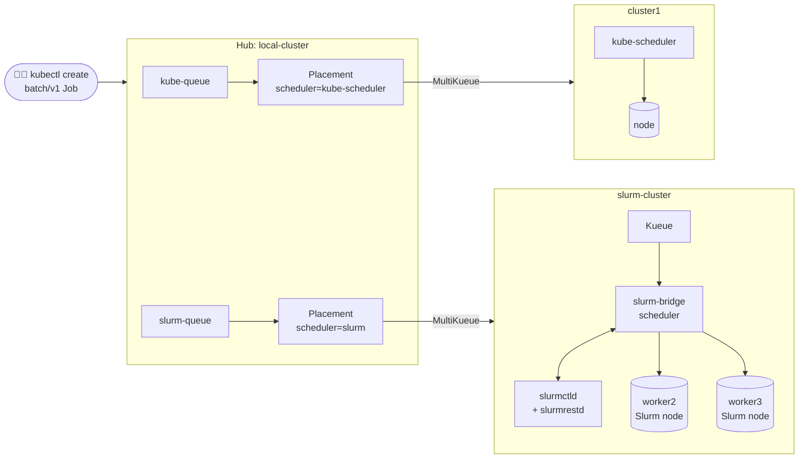

# MultiKueue with other schedulers: Kubernetes and Slurm behind one queue

> Submit the same Kubernetes Job to one hub. Send it to `kube-queue` and the default
> kube-scheduler runs it. Send it to `slurm-queue` and **Slurm** decides where and when it
> runs. Users never see a Slurm login node, and Slurm admins keep their scheduler.

Many organizations run two worlds: Kubernetes clusters for services and newer AI workloads, and
Slurm clusters for HPC and large training jobs. This example shows that MultiKueue doesn't care
which scheduler places pods on a worker. The hub only decides *which cluster* gets a job. Each
worker then places the pods with its own scheduler.

| Layer | Who decides | Tool |
|---|---|---|
| Which cluster | Hub | OCM `Placement` + Kueue **MultiKueue** |
| Whether it fits the team's quota | Hub and worker | Kueue `ClusterQueue` |
| Which node, and when | Worker | kube-scheduler on `cluster1`, **Slurm** on `slurm-cluster` |

On `slurm-cluster`, [slurm-bridge](https://github.com/SlinkyProject/slurm-bridge) is the pod
scheduler. It turns each pod into a Slurm job, waits for Slurm to allocate a node, and then binds
the pod there. [slurm-operator](https://github.com/SlinkyProject/slurm-operator) runs the Slurm
control plane (`slurmctld` and `slurmrestd`) as pods in the same cluster.

---

## Architecture



`slurm-cluster` is a 4-node kind cluster running Kubernetes v1.35.0:

| Node | Role |
|---|---|
| `control-plane` | Kubernetes control plane |
| `worker` | System node: slurmctld, slurmrestd, slurm-operator, slurm-bridge, Kueue, OCM agents |
| `worker2`, `worker3` | Batch nodes. Labelled `scheduler.slinky.slurm.net/external-node=true`, so slurm-bridge registers them in Slurm, and tainted so that only slurm-bridge places pods there |

The batch nodes run no `slurmd`. slurm-bridge registers them in Slurm as **external nodes**, with
their real CPU and memory, in the `slurm-bridge` partition:

```
NODELIST PARTITION CPUS MEMORY STATE
slurm-cluster-worker2 slurm-bridge* 16 63991 idle
slurm-cluster-worker3 slurm-bridge* 16 63991 idle
```

---

## Quick start

You need the environment from [`build/setup-env.sh`](../../build/setup-env.sh). This example
reuses its hub (`local-cluster`) and `cluster1`, and adds a new cluster.

```bash
sudo sysctl fs.inotify.max_user_instances=2048   # kind nodes need inotify instances
cd examples/multikueue-slurm
./create-slurm-cluster.sh   # new kind cluster + Slurm + slurm-bridge + Kueue, joined to OCM
./setup.sh                  # hub queues, Placements and worker LocalQueues
./demo.sh                   # narrated live walk-through (PAUSE=6 ./demo.sh when presenting)
./teardown.sh               # remove everything this example added
```

`create-slurm-cluster.sh` installs these versions:

| Component | Version |
|---|---|
| Kubernetes (kind node image) | v1.35.0 (slurm-bridge 1.2.x needs 1.35 or newer) |
| slurm-operator, Slurm chart, slurm-bridge | 1.2.4 (Slurm 26.05) |
| cert-manager | v1.21.2 |
| Kueue | v0.20.5 |

### Onboarding is one `clusteradm join`

The script joins `slurm-cluster` to the hub with `clusteradm`. Within about a minute, the OCM
addons have done the rest on their own:

- `managed-serviceaccount` creates the token MultiKueue uses, and rotates it.
- `kueue-addon` creates the kubeconfig secret and the `MultiKueueCluster`, and deploys the
  worker's `cluster-queue`.
- The `hpc-workers` ManifestWorkReplicaSet pushes the `hpc` namespace and LocalQueues as soon as
  `setup.sh` labels the cluster.

The hub auto-approves the certificate request from a cluster name's first join, but not from a
rejoin under the same name (for example after `teardown.sh`). The script approves the cluster's
pending CSRs itself, which is what `clusteradm accept` does.

---

## The jobs

[`workloads/01-job-kube-scheduler.yaml`](workloads/01-job-kube-scheduler.yaml) and
[`workloads/02-job-slurm.yaml`](workloads/02-job-slurm.yaml) are the same plain `batch/v1` Job.
They differ only in name and queue:

```yaml
apiVersion: batch/v1
kind: Job
metadata:
  generateName: train-slurm-
  namespace: hpc
  labels:
    kueue.x-k8s.io/queue-name: slurm-queue        # ← kube-queue in the other file
  annotations:
    slurmjob.slinky.slurm.net/job-name: train-slurm
    slurmjob.slinky.slurm.net/timelimit: "10"     # Slurm time limit, in minutes
spec:
  suspend: true
  template:
    spec:
      containers:
      - name: train
        image: busybox:1.36
        resources:
          requests: {cpu: "1", memory: 256Mi}
```

There is no `schedulerName` in the Job. On `slurm-cluster`, slurm-bridge's admission webhook
sets `schedulerName: slurm-bridge-scheduler` on every pod in the `hpc` namespace. The
`slurmjob.slinky.slurm.net/*` annotations become Slurm job options. MultiKueue copies the
annotations to the worker, so users can set Slurm options from the hub. The default scheduler
on `cluster1` ignores them.

---

## What `demo.sh` shows

### 1. The same Job, two schedulers

One Job goes to each queue. The kube-scheduler places one pod on `cluster1`. On
`slurm-cluster` the pod waits for Slurm, and `squeue` shows it as a Slurm job:

```
[hub] Kueue workloads
  WORKLOAD                       QUEUE        ADMITTED  FINISHED  WORKER
  job-train-kube-4pjbj-8f7cf     kube-queue   True      <none>    cluster1
  job-train-slurm-mclnx-388ac    slurm-queue  True      <none>    slurm-cluster
[cluster1] pods, placed by kube-scheduler
  train-kube-4pjbj-wglvh     scheduler=default-scheduler       node=cluster1-control-plane  Running
[slurm-cluster] pods, placed by Slurm
  train-slurm-mclnx-9rzxs    scheduler=slurm-bridge-scheduler  node=slurm-cluster-worker2   Running
[slurm-cluster] squeue
   JOBID         NAME     STATE               NODELIST     TIME REASON
       1  train-slurm   RUNNING  slurm-cluster-worker2     0:09 None
```

### 2. Kueue admits, Slurm places

Four Slurm jobs, but only two Slurm nodes. Kueue's quota allows all four, so the hub admits every
workload. By default slurm-bridge gives each pod a whole node, so Slurm runs two and **queues the
others in its own queue**:

```
[hub] Kueue workloads
  WORKLOAD                       QUEUE        ADMITTED  FINISHED  WORKER
  job-train-kube-4pjbj-8f7cf     kube-queue   True      True      cluster1
  job-train-slurm-mclnx-388ac    slurm-queue  True      True      slurm-cluster
  job-train-slurm-9nf7k-2dc20    slurm-queue  True      <none>    slurm-cluster
  job-train-slurm-dl5hk-7b87b    slurm-queue  True      <none>    slurm-cluster
  job-train-slurm-j555j-b5821    slurm-queue  True      <none>    slurm-cluster
  job-train-slurm-jfrt9-9d944    slurm-queue  True      <none>    slurm-cluster
[cluster1] pods, placed by kube-scheduler
[slurm-cluster] pods, placed by Slurm
  train-slurm-9nf7k-f6vwt    scheduler=slurm-bridge-scheduler  node=<none>                  Pending
  train-slurm-dl5hk-sq8qh    scheduler=slurm-bridge-scheduler  node=<none>                  Pending
  train-slurm-j555j-j86r7    scheduler=slurm-bridge-scheduler  node=slurm-cluster-worker3   Pending
  train-slurm-jfrt9-rcs7h    scheduler=slurm-bridge-scheduler  node=slurm-cluster-worker2   Running
[slurm-cluster] squeue
   JOBID         NAME     STATE               NODELIST     TIME REASON
       5  train-slurm   PENDING                            0:00 None
       4  train-slurm   PENDING                            0:00 Resources
       2  train-slurm   RUNNING  slurm-cluster-worker2     0:03 None
       3  train-slurm   RUNNING  slurm-cluster-worker3     0:03 None
```

All four workloads are admitted on the hub, but only two pods have a node. The two with
`node=<none>` are the ones Slurm is holding as jobs 4 and 5. (The pod on worker3 already has its
node and is still starting its container.) When the first two finish, Slurm starts jobs 4 and 5.
The queueing shows in the hub's job durations: in one run, about 37 seconds for the jobs that
started right away and 85 seconds for the ones that waited. Everything finishes, and the status
syncs back to the Jobs on the hub.

This is the split of responsibilities: **Kueue** enforces quotas and picks the cluster,
**Slurm** applies its own policies (whole-node allocation, priority, time limits) to decide which
node runs what, and when.

---

## Things to know

- **Workers need every integration's CRD.** MultiKueue opens a watch on each worker for every
  job integration that the hub's Kueue enables (JobSet, MPIJob, Ray, LWS, TrainJob and more). If
  any type is missing, the `MultiKueueCluster` stays inactive with an error such as `no matches
  for kind "JobSet"`, even if that worker will never run one.
  [`slurm-cluster/install-integration-crds.sh`](slurm-cluster/install-integration-crds.sh)
  installs only the CRDs, without their controllers.
- **Slurm's stand-in jobs end as `CANCELLED`.** slurm-bridge represents each pod as a Slurm job
  and cancels it when the pod finishes, so `scontrol show job` lists finished pods as
  `CANCELLED`. The Kubernetes Job still reports `Complete`.
- **No Slurm accounting.** The Slurm chart runs without `slurmdbd`, so `sacct` is unavailable.
  Use `squeue` and `scontrol show job`.
- **Whole-node allocation.** slurm-bridge gives each pod an entire Slurm node by default. Shared
  nodes need Slurm MCS and the `mcsLabel` setting in slurm-bridge.
- **The hub doesn't know about Slurm.** Kueue's quota on the hub and on the worker counts the
  Job's resource requests, not Slurm's whole-node allocation. That's why the hub admits four jobs
  that Slurm then queues. Size quotas to match how Slurm allocates if you don't want work waiting
  in Slurm.
- **Effects on the other examples.** `slurm-cluster` joins the same hub, so any Placement that
  selects "all workers" now includes it. For example, the `default` Placement adds it to
  `MultiKueueConfig default`, and the LWS example's `lws-workers` ManifestWorkReplicaSet pushes
  its LocalQueues to it. `teardown.sh` removes the cluster and all of these.
- **Supported workloads.** slurm-bridge also schedules Pods, JobSets, PodGroups and
  LeaderWorkerSets. This example uses a plain `batch/v1` Job to keep the comparison simple.

## Files

```
multikueue-slurm/
├── create-slurm-cluster.sh            # kind + Slurm + slurm-bridge + Kueue, joined to OCM
├── setup.sh                           # hub labels, Placements, queues, worker LocalQueues
├── demo.sh                            # narrated live demo
├── teardown.sh                        # remove everything this example added
├── slurm-cluster/
│   ├── kind.yaml                      # 1 system node + 2 Slurm-managed batch nodes
│   ├── slurm-values.yaml              # Slurm control plane, slurm-bridge partition
│   ├── bridge-values.yaml             # slurm-bridge manages the hpc namespace
│   ├── token.yaml                     # JWT for slurm-bridge to call slurmrestd
│   └── install-integration-crds.sh    # CRDs MultiKueue needs on every worker
├── hub/
│   ├── placements.yaml                # kube-batch, slurm
│   ├── queues.yaml                    # AdmissionChecks, ClusterQueues, LocalQueues
│   └── worker-queues.yaml             # ManifestWorkReplicaSet: hpc LocalQueues on workers
└── workloads/
    ├── 01-job-kube-scheduler.yaml     # → kube-queue
    └── 02-job-slurm.yaml              # → slurm-queue
```

The Slurm and slurm-bridge settings are based on `hack/` in
[SlinkyProject/slurm-bridge v1.2.4](https://github.com/SlinkyProject/slurm-bridge/tree/v1.2.4/hack).
